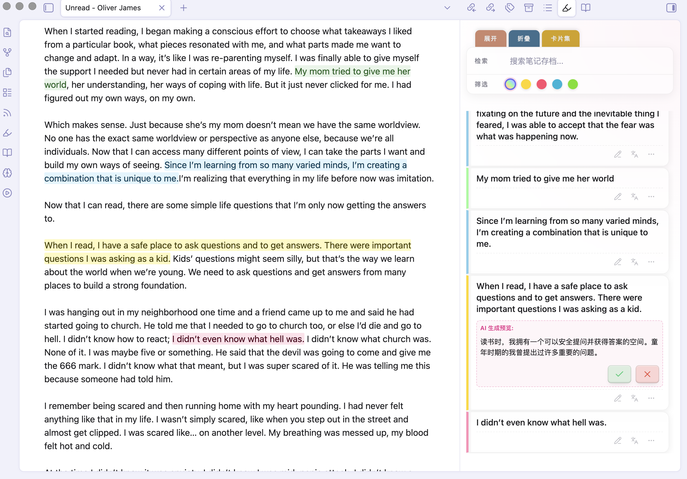
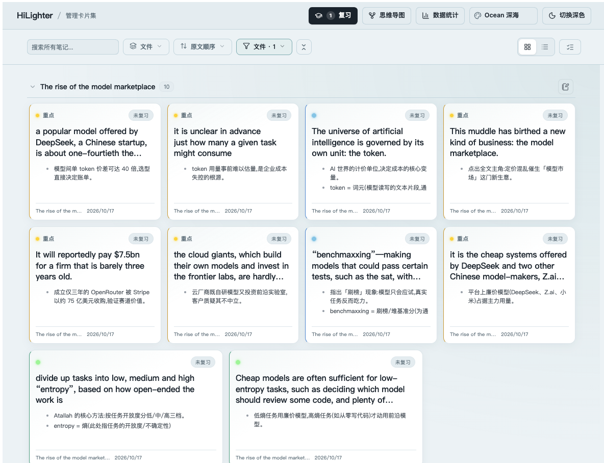
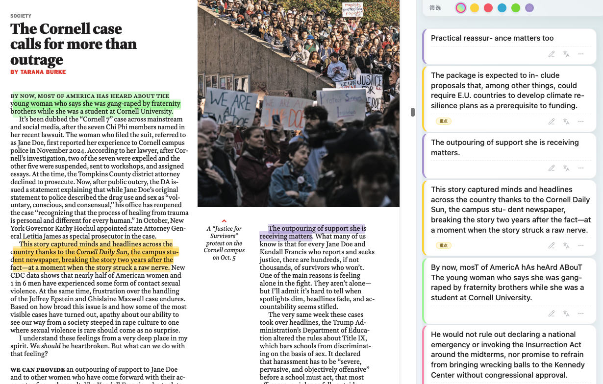
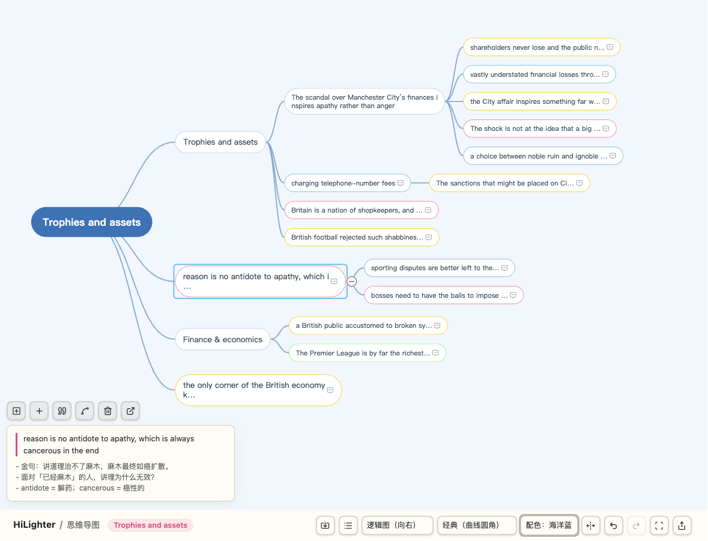

# HiLighter - Obsidian ハイライトノート管理ツール

[](https://github.com/pandorareads/hilighter/releases)
[](https://obsidian.md)

**English** | [简体中文](./README_ZH.md) | **日本語** | [한국어](./README_KO.md) | [Français](./README_FR.md) | [Deutsch](./README_DE.md) | [Español](./README_ES.md) | [Português](./README_PT.md) | [Русский](./README_RU.md)

---

**HiLighter** は、ハイライトノートの管理に特化した Obsidian プラグインです。ハイライトした内容を管理しやすいノートカードに変換し、多色のマーキング、AI による分析、スマート検索に対応しているため、ノート整理がより効率的になります。Markdown・PDF・EPUB に対応しています。



## ✨ 主な機能

### 🎨 ハイライトノートカード管理
*   **サイドバー管理**：現在のドキュメントまたは Vault 全体の `<mark>` ハイライトを集約し、カードをクリックすると原文へ瞬時にジャンプできます。
*   **多次元フィルター**：
    *   **色フィルター**：黄・ピンク・青・緑の 4 色で素早く分類。
    *   **キーワード検索**：上部の検索バーでノートの内容をリアルタイムに絞り込み。
*   **AI によるインテリジェンス**：
    *   **AI 翻訳 (Languages)**：ハイライトした文をワンクリックで正確に翻訳。
    *   **AI リサーチ (Microscope)**：複数の研究プロンプトテンプレート（哲学的分析、簡潔な要約、批判的分析）を内蔵し、**カスタム研究プロンプト**にも対応 — 自由に追加・編集・切り替えができ、さまざまな深読みシーンに対応します。
*   **柔軟な操作**：
    *   **クイック編集**：鉛筆アイコンをクリックするとカード上で直接ノートを編集でき、高さは自動調整されます。
    *   **タグシステム**：カスタムタグに対応し、スマートなタグ候補アルゴリズムを内蔵。
    *   **カードコレクション**：ワンクリックで全画面の「カードスタジオ」モードに切り替え、インスピレーションを一元管理できます。
*   **ノートカード管理**：
    *   **原文へ移動**：カードをクリックすると元ノートのハイライト位置へ即座にジャンプし、文脈を素早く復元できます。
    *   **分類タグ**：各カードにタグを付けて整理でき、タグの一括操作にも対応。
    *   **一括削除**：一括モードで複数のカードを選択し、ワンクリックで削除して効率的に整理できます。



### 📄 PDF アノテーション（2.5 の新機能）
*   **PDF 内で直接ハイライト**：任意の PDF でテキストを選択して色を指定すると、ページに半透明の蛍光マーカーが表示され、同時にノートカードが作成されます。メモ・タグ・フラッシュカード復習・マインドマップは、Markdown のハイライトとまったく同じように機能します。
*   **マークの永続化**：すべてのハイライトはページのジオメトリにアンカーされるため、ページ送り・ファイルを閉じて開き直す・ズーム・デバイス間の Vault 同期でも位置が維持されます。
*   **カードとの双方向同期**：カードを削除すると PDF 上のマークもすぐに消え、カードの色を変更するとマークも即座に更新されます。
*   **正確な文へジャンプ**：カードをクリックすると PDF 内のハイライトされた文へ直接スクロールし、一瞬ハイライトして位置を示します。



### 📖 EPUB 閲覧とハイライト（2.6 の新機能）
*   **Vault 内の EPUB を読む**：任意の `.epub` ファイルをクリックすると HiLighter リーダーで開きます（設定 → ファイルとリンクで「すべてのファイル拡張子を検出」を有効にするか、「EPUB を開く」コマンドを使ってください）。書籍ごとに読書位置を記憶します。
*   **ハイライトとノート**：テキストを選択して同じメニューで 4 色ハイライト — AI 翻訳・AI リサーチにも対応。マークは CFI でアンカーされるため、再オープン・ページめくり・Vault 同期後も位置を保持し、カードの削除・色変更は即座に書籍ページへ反映されます。
*   **カードで原文へ**：ハイライトはノートカードになり、クリックすると元の文へジャンプして点滅表示します。
*   **リーダーツールバー**：目次ドロップダウンによる章ジャンプ、自動生成ページ番号によるページジャンプ、しおり（現在のページを登録・一覧からジャンプ・随時削除）。
*   **2 つの読書モード**：横方向ページめくり（ボタンまたは左右スワイプ）⇄ 縦方向連続スクロールをいつでも切替、位置は保持されます。

### 🧠 マインドマップ（2.4 の新機能）
*   **ワンクリック生成**：任意のファイルのすべてのハイライトをマインドマップとして取り込み — ドキュメント見出し・ハイライトの色・タグ・フラットな順序でグループ化できます。
*   **Xmind 風の編集**：ドラッグでトピックの親子関係や並び順を変更、Tab/Enter/Delete ショートカット、ダブルクリックでインライン編集、ブランチの折りたたみ/展開、元に戻す/やり直し、任意の 2 つのトピック間に関連線を作成。
*   **9 種類の構造**：バランス型マインドマップ、ロジック図（右/左）、組織図、横/縦タイムライン、フィッシュボーン、カタログ組織図 — いつでも切り替え可能。
*   **6 スタイルテーマ × 8 カラーパレット**：線の形状と太さ（曲線、直線、レインボーブランチ線）とフルカラースキーム（背景、ノードの塗り/枠線は階層ごとに薄くなるほか、カードの色を活かしたカラフルな方案も）を組み合わせ。
*   **要約とノート**：トピックに要約ノードを付けたり、任意のトピックにメモを添えたりでき、元のハイライトへすぐに戻れます。
*   **インポート/エクスポート**：`.xmind` ファイルを直接開けるほか、PNG、`.xmind`（Xmind で再オープン可能）、Markdown アウトライン、Obsidian の `.canvas` ボードにエクスポートできます。



### ⚡ フラッシュカード復習 (FSRS)
*   **間隔反復**：内蔵の FSRS スケジューリングにより、ハイライトカードをフラッシュカード化し、期限付きキューとカードごとの復習状態を管理します。
*   **集中復習セッション**：Space キーでカードをめくり、想起度を 1〜4（Again/Hard/Good/Easy）で評価、スキップやアーカイブも可能 — すべてキーボード操作。
*   **復習インサイト**：スタジオのツールバーに期限切れ/新規カード数を表示し、統計ダッシュボードで復習データを分析できます。

---

## 🚀 クイックスタート

### インストール
1. **手動インストール（推奨）：**
    *   最新版の 3 つの主要ファイル（`main.js`、`manifest.json`、`styles.css`）を取得します。
    *   Vault フォルダの `.obsidian/plugins/hilighter/` に配置します。
    *   設定 > サードパーティプラグインでプラグインを有効化します。
2. **コミュニティプラグイン：** Obsidian のコミュニティプラグインブラウザで `HiLighter` を検索して直接インストールできます。

### 基本設定
1.  **AI LLM API（重要）**：AI 翻訳・AI リサーチ機能を使うには、プラグイン設定で AI LLM API を構成してください。DeepSeek、Google Gemini、Volcano Engine (Ark) など主要プロバイダに対応しています。
2.  **リボンアイコン**：設定でサイドバーのハイライトノートアイコンの表示を切り替えられます。

---

## 🤖 エージェントスキル：1つのプロンプトでノート全体をハイライト

オプションの [`pandora-hilight`](../skills/pandora-hilight/SKILL.md) スキルを使うと、AI エージェント（ZCode、Claude Code など）がノートを処理します：ハイライトに値する文を選び、意味に応じて色を割り当て（黄=要点、青=概念、緑=方法、ピンク=名言）、各ハイライトに学習ノートを書き、そのまま HiLighter に保存します。スキルはあなたの言語で対話します — 日本語で聞けば、日本語で案内し、日本語でノートを書きます。

**インストール** — 下のブロックをコピーしてエージェントに送るだけです：

```text
Please install the pandora-hilight skill from https://github.com/PandoraReads/HiLighter:
1. Sparse-clone the repo: git clone --depth 1 --filter=blob:none --sparse https://github.com/PandoraReads/HiLighter /tmp/hilighter-repo && cd /tmp/hilighter-repo && git sparse-checkout set skills/pandora-hilight
2. Copy the skills/pandora-hilight folder into your own skills directory so the skill loads in future sessions.
3. Verify that SKILL.md exists with a valid frontmatter, clean up /tmp/hilighter-repo, and tell me how to trigger the skill.
```

インストール後は、エージェントに「このノートをハイライトして」と言うか、`/pandora-hilight` を実行するだけです。Vault に HiLighter プラグインがインストールされている必要があります。スキルはハイライトをプラグインの同期ファイル（`.hilighter/sync-data.json`）に書き込み、インポートを自動でトリガーします。

手動がよければ一行で：

```bash
git clone --depth 1 https://github.com/PandoraReads/HiLighter /tmp/hl && mkdir -p ~/.zcode/skills && cp -r /tmp/hl/skills/pandora-hilight ~/.zcode/skills/ && rm -rf /tmp/hl
```

---

## 🔄 データ同期


HiLighter はハイライトをデバイスごとの IndexedDB に保存しますが、Vault 内の同期ファイル（デフォルト `.hilighter/sync-data.json`）を介して複数デバイス間で同期できます。設定で**同期**を有効にし、**iCloud** や **Obsidian Sync** でそのファイルを同期してください。

- **自動インポート**：プラグインは同期ファイルを監視し、他のデバイスの変更を自動的にマージします（約 30 秒間隔のポーリング + ウィンドウフォーカス時）。
- **自動エクスポート**：ローカルの変更は（約 20 秒のデバウンスで）書き戻されます。書き出し前にリモートファイルをマージするため、他のデバイスのデータを上書きしません。
- **削除の伝播**：軽量なトゥームストーン（30 日後に整理）で削除を伝播します。
- **追加/更新のみ**：同期は行をマージするだけで、明示的にトゥームストーン化されていない行を削除することはありません。Obsidian Sync の `*-conflicted-*` コピーは読みません。

**Vault へエクスポート** / **Vault からインポート** コマンドで手動同期も可能です。

### ディープリンク

`obsidian://hilighter?op=...` は以下をサポートします:

| op | アクション |
|---|---|
| `sync-import` | 同期ファイルからインポート |
| `sync-export` | 同期ファイルへエクスポート |
| `sync` | インポートしてからエクスポート |
| `open-studio` | カードスタジオを開く |
| `open-view` | ハイライトサイドバーを開く（`&side=main` でメインエリアに開く） |

iOS ショートカットや他のアプリから利用できます。`vault=` パラメータがない場合、最後にアクティブだった Vault が対象になります。

---

## 🛠 開発とビルド

本プロジェクトの改善への貢献を歓迎します！

*   **要件**：NodeJS (v16+)
*   **依存関係のインストール**：`npm install`
*   **開発モード**：`npm run dev`
*   **本番ビルド**：`npm run build`

---

## ❤️ サポートとフィードバック

このプラグインを気に入っていただけたら、以下の方法でサポートできます:

*   **公式アカウントをフォロー**：潘多拉的数字花园 (Pandora's Digital Garden)
*   **Bilibili**：Bilibili で 潘多拉的数字花园 をフォローして動画チュートリアルを見る
*   **マルチプラットフォーム対応**：Weibo、Xiaohongshu (Little Red Book)、Knowledge Planet でも同名で展開しています
*   **連絡とフィードバック**：VX: **PandoraReads** までお気軽にどうぞ

### ☕ コーヒーをおごる

HiLighter がお役に立てたなら、開発者にコーヒーをおごっていただけます（Alipay / WeChat でスキャン）:

<p align="center">
  
</p>

---

## 更新履歴

### v2.6.0 (2026-10-26)
- **しおりと読書モード**：リーダーツールバーにしおり機能（現在のページを登録、一覧からジャンプ、ワンクリック削除）が追加され、従来の「前回の位置に戻る」ボタンを置き換えました。さらにページ⇄スクロールモード切替に対応——横方向のページめくり（ボタンまたは左右スワイプ）と縦方向の連続スクロールを切り替えられ、切替時も位置を保持し、スクロール中は読書位置が自動保存されます。
- **EPUB リーダーツールバー**: 目次ドロップダウン（章をクリックしてジャンプ）、ページジャンプ（自動生成されたページ番号をスライダーと入力で指定、書籍ごとにキャッシュ）、「前回の読書位置に戻る」ボタンを追加。目次・ページ・カードからのジャンプでは保存済みの読書位置を上書きしないため、いつでも本当に読み終えた場所に戻れます。
- **カードの並び順**: 現在の EPUB のハイライトカードは作成順ではなく書籍の読み順（CFI 位置）に並ぶようになりました。スタジオの原文順ソートも同じ比較器を使用します。
- **EPUB 閲覧とハイライト（修正）**：Vault 内の EPUB ファイルが HiLighter リーダーで正しく開くようになりました。以前はビューが FileView として登録されておらずファイルを受け取れず、真っ白なままだったためです。テキストを選択して 4 色でハイライトでき、カードをクリックすると元の文へジャンプして点滅表示し、カードの削除・色変更は即座に書籍ページへ反映されます。破損した書籍は読みやすいエラー表示と再試行ボタンを示します。

### v2.5.1 (2026-10-25)
- **AI モデル設定**：プリセットがフォーム全体を事前入力するようになりました（API キーのみ入力）。 「モデル一覧を取得」ボタンで、キーが実際に使えるモデル ID を取得でき、一般的な製品名（例：`deepseek-v3`）は実際の API モデル ID に自動修正されます。400/404 エラー時には、キーで利用可能なモデル一覧が表示されます。
- **Kimi 修正**：新しい Kimi キーは `kimi-*` モデルのみを提供し（プリセットのデフォルトは `kimi-latest` に変更）、k2.6+ は temperature 1 のみ受け付けます — エディタでモデルごとに温度を設定できるようになりました。
- **AI 解説**：テキスト選択ツールバーに「AI 解説」ボタンが追加され、短い注釈がノート欄に直接書き込まれます。全文 AI 解析パネルは削除されました。
- **修正**：プリセットピッカーがスクロール可能になり、設定ページは編集後もスクロール位置を保持します。

### v2.5.0 (2026-10-25)
- **PDF ハイライト**：任意の PDF でテキストを選択して色を指定すると、ページに半透明のマークが現れ、ノートカードが作成されます。マークはページ相対の選択ジオメトリにアンカーされるため、ページ送り・再オープン・ズーム・Vault 同期でも位置が維持されます。
- **正確な文へジャンプ**：PDF カードをクリックするとハイライトされた文へスクロールし、約 1.2 秒間フラッシュ表示します（以前はページ単位のみ）。
- **双方向同期**：カードを削除すると PDF のマークはすぐに消え、カードの色を変更するとマークは即座に更新されます。
- **修正**：PDF ハイライトキャプチャの長年のクラッシュ（ページアンカーが保存されていなかった）、オーバーレイ再描画のフィードバックループ、カスタムハイライト色がサイドバーカードのストライプに反映されない問題を修正しました。

### v2.4.1 (2026-10-24)
- **プラグインディレクトリ修正**：manifest 名を ASCII のみの "HiLighter" に戻しました（コミュニティディレクトリは非 ASCII 名を拒否し、エントリが非表示になっていました）。バイリンガルの説明は変更ありません。

### v2.4.0 (2026-10-24)
- **マインドマップ（新機能）**：カードスタジオに「マインドマップ」エントリが追加され、ファイルの全ハイライトをマインドマップとして取り込めます（見出し・色・タグ・フラットでグループ化）。Xmind 風の編集：ドラッグで親子関係変更、Tab/Enter/Delete ショートカット、折りたたみ/展開、元に戻す/やり直し、トピック間の関連線に対応。
- **マインドマップの構造とテーマ**：バランス/右/左ロジックレイアウトに加え、組織図、横/縦タイムライン、フィッシュボーン、カタログ構造。6 スタイルテーマ（線の形状・太さ・レインボーブランチ線・ノード形状）× 8 カラーパレット（背景/線/枠線の配色、階層ごとに薄くなる枠線、カードカラーを活かした方案）。
- **マインドマップの統合**：ハイライトカードはノードとリンクされたまま（編集は再同期、削除されたカードはフラグ付き）、ノードから元テキストへジャンプでき、マップはデバウンス付きで自動保存されます。
- **マインドマップのインポート/エクスポート**：`.xmind` ファイルのインポート（新旧形式、最初のシート）；PNG、`.xmind`、Markdown アウトライン、Obsidian の `.canvas` ボードへのエクスポート。
- **Markdown ノート**：ギャラリーカードと拡大カードダイアログがノートの Markdown をレンダリングするようになりました（ダイアログ内で書き込み/プレビュー切り替え）。
- **UI 言語**：日本語、韓国語、フランス語、ドイツ語、スペイン語、ポルトガル語、ロシア語を追加（部分翻訳、英語フォールバック付き）、「Obsidian 言語に従う」オプションも追加。
- **UI 改善**：スタジオのトップバーのタイポグラフィと高さを統一、テーマセレクタにパレットアイコン、サイドバーとスタジオのスクロールバーを透明化、サイドバーのハイライト一覧にトップへ戻るボタンを追加。
- **データ**：マインドマップドキュメントを IndexedDB に永続化（スキーマ v5、追加のみ — 移行不要）。

### v2.3.0 (2026-10-23)
- **カードスタジオ**：原文順ソートをデフォルトとして追加、レスポンシブなカードレイアウト、摘録の高さを統一、拡大カードダイアログでの直接編集、単一カードまたはグループ全体の Markdown エクスポート（設定した Vault フォルダへ）に対応。
- **テーマとカード**：テーマとライト/ダークのスタイリングを改善。Ocean、Forest、Galaxy、Sunset、Rose は左のカラーレールの代わりにカラードットのアクセントを使用。「My Note」カードラベルを削除し、色の別名・ピン配置・復習状態の配置を改善しました。
- **フラッシュカード復習**：カードの寸法と文字スケールを改善し、復習フローと評価状態をより明確にしました。
- **ハイライトノート**：選択ツールバーにノートのエントリポイントを追加、Cmd/Ctrl クリックとダブルクリックでトリガー、ハイライトのホバー時にノートをプレビュー。
- **画像と設定**：ノート編集中の画像レンダリングを修正；画像の貼り付け/ドロップに対応し、画像フォルダを設定可能に。
- **スタジオツール**：グループエクスポートとトップへ戻るコントロールを追加し、グループ化/フィルターレイアウトの挙動を改善しました。

---

*「ハイライトノートがインスピレーションの触媒になりますように。」— HiLighter*
