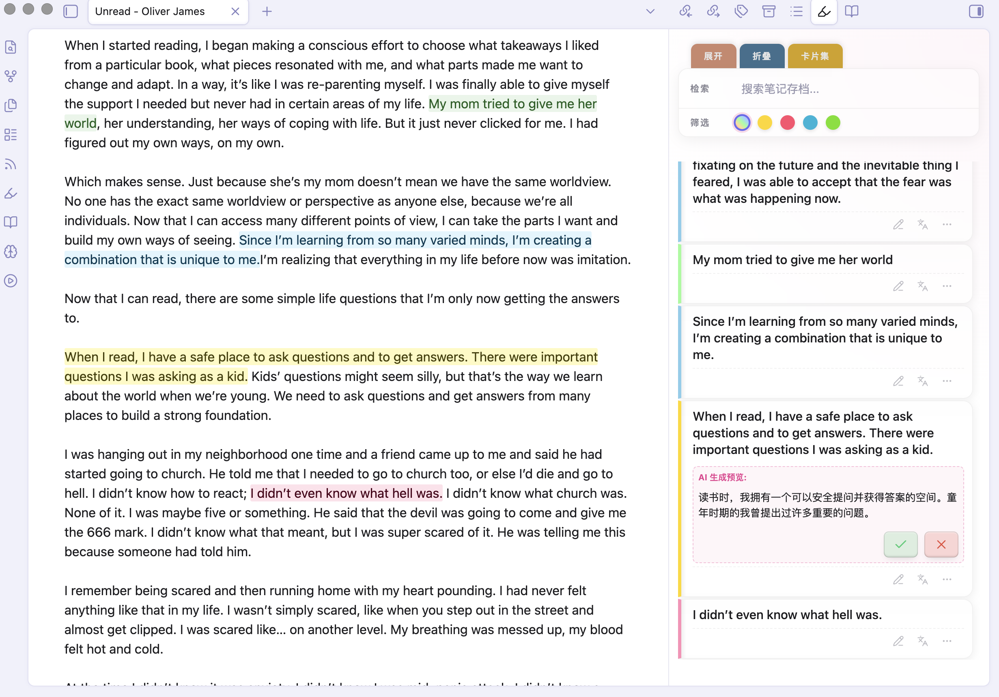
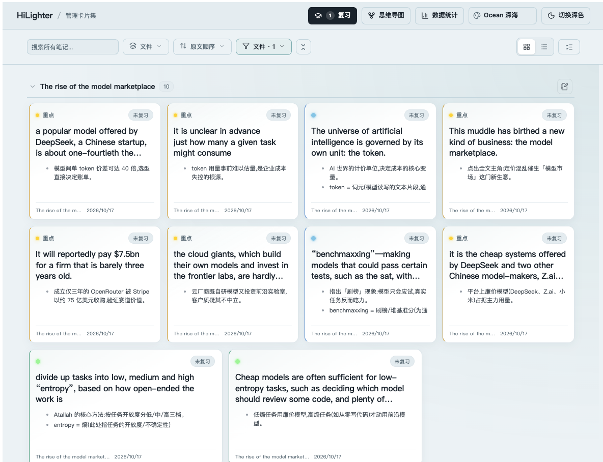
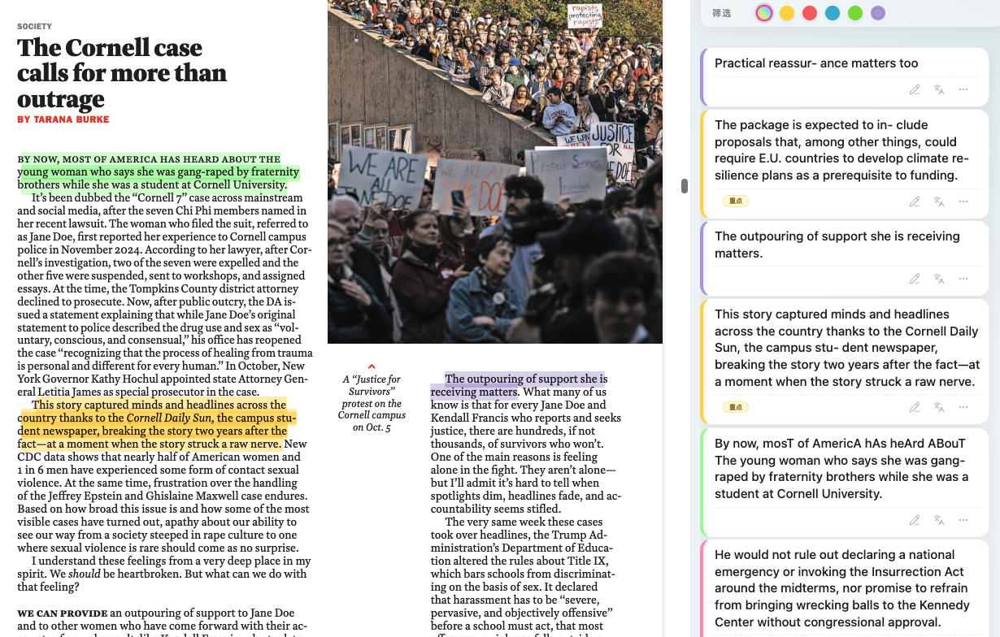
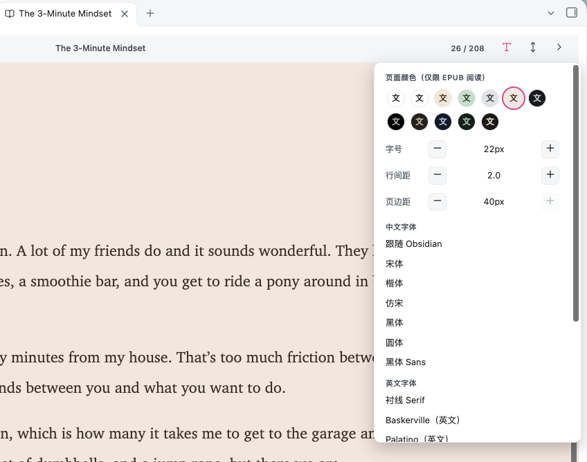
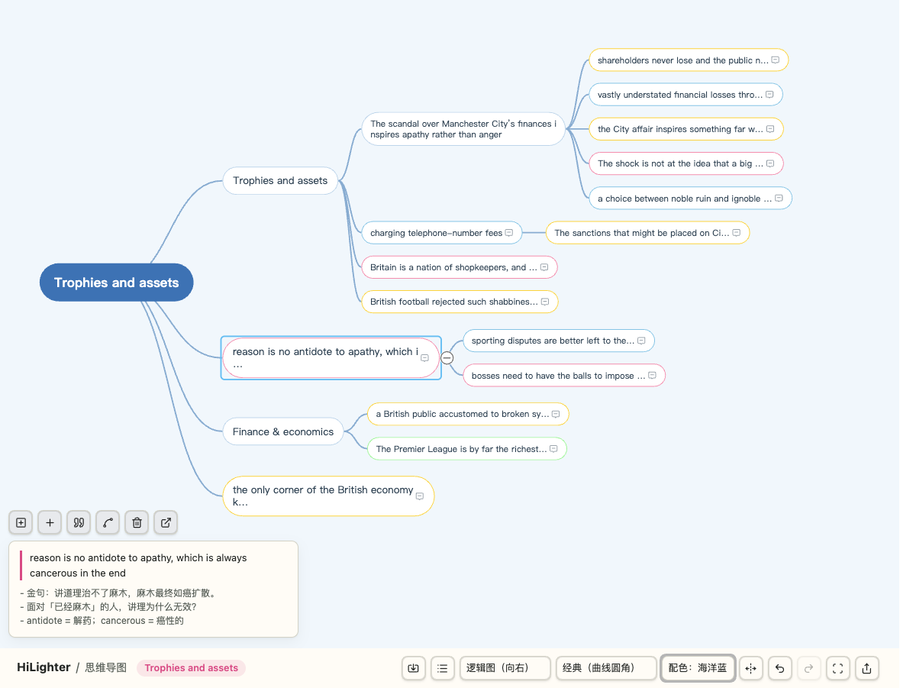

# HiLighter - Obsidian 高亮笔记管理工具

[](https://github.com/PandoraReads/HiLighter/releases/)
[](https://obsidian.md)

**HiLighter** 是一款专注于高亮笔记管理的 Obsidian 插件。它将高亮内容转化为可管理的笔记卡片，支持多种颜色标注、AI辅助分析和智能搜索功能，让你在阅读和中实现更高效的笔记管理和研究。支持 Markdown、PDF 与 EPUB。

**🌐 Languages / 语言**: [English](../README.md) | **简体中文** | [日本語](./README_JA.md) | [한국어](./README_KO.md) | [Français](./README_FR.md) | [Deutsch](./README_DE.md) | [Español](./README_ES.md) | [Português](./README_PT.md) | [Русский](./README_RU.md)

---



## ✨ 核心特性

### 🎨 高亮笔记卡片管理 (Highlight Note Cards)
*   **侧边栏管理**：汇总当前文档或所有库文件中的 `<mark>` 高亮内容，支持**点击卡片瞬间跳转**至原文。
*   **多维筛选**：
    *   **颜色过滤**：支持按黄色、粉色、蓝色、绿色四种高亮颜色快速分类。
    *   **关键词检索**：在顶部搜索框实时过滤笔记内容。
*   **AI 深度赋能**：
    *   **AI 翻译 (Languages)**：一键获取高亮句子的精准翻译。
    *   **侧栏 AI 对话**：接入已配置的大模型，选取一张或多张卡片作为上下文，输入问题或使用预置、自定义研究提示词；回答可保存为关联所选卡片的联想卡片。点击箭头或按 Enter 发送，Shift+Enter 换行。
*   **灵活交互**：
    *   **快速编辑**：点击卡片笔记区直接编辑；卡片详情弹窗自动保存，退出输入状态后渲染 Markdown。
    *   **标签系统**：支持为卡片添加自定义标签，内置智能推荐算法。
    *   **卡片集导航**：一键切换至全屏”卡片工作室”模式，集中管理所有灵感。
*   **卡片方法与知识链接**：高亮后仍立即生成摘录卡；随后可选择康奈尔笔记、一页纸综合或卢曼想法卡，给卡片命名，并连接相关卡片。不同方法在侧栏与卡片集中使用对应版式。详见[方法依据与使用路径](CARD-TEMPLATES-AND-LINKS.md)。
*   **笔记卡片管理**：
    *   **原文定位**：点击卡片即可瞬间跳转至原文高亮位置，快速回到上下文。
    *   **分类标签**：为每张卡片添加标签进行分类整理，支持批量标签操作。
    *   **批量删除**：进入批量模式，多选卡片后一键删除，高效清理无用笔记。
    *   **卡片层级**：拖到目标卡片上部可设为下级，拖到下边缘可放在目标卡片下方作为同级；支持多选后一起拖动。同一篇文章最多支持三层，拖到列表空白处可移回顶级。
    *   **动态引用卡片**：将侧栏卡片拖入 Markdown 笔记，生成随卡片内容更新的引用；引用内可打开卡片编辑或移除引用。
*   **查词与翻译**：选中文字后点击查词图标，先查看词典释义、再查看翻译；中文词条使用维基词典，英文词条使用 Free Dictionary API，发音使用设备可用的本地语音。



### 📄 PDF 标注 (2.5 新增)
*   **PDF 内直接高亮**：在任意 PDF 中划选文字、点选颜色——页面上即刻出现半透明荧光标记，同时生成笔记卡片；笔记、标签、闪卡复习、思维导图与 Markdown 高亮完全一致。
*   **标记持久保存**：每个高亮锚定在页面几何位置上，翻页、关闭重开、缩放、跨设备同步后都保持在原位。
*   **与卡片双向联动**：删除卡片，PDF 上的标记立刻消失；卡片换色，标记即时更新。
*   **精确跳转**：点击卡片直接滚动到 PDF 中被高亮的句子，并闪烁定位。
*   **框选截图生成卡片**：在 PDF 阅读器中通过工具条或 `Ctrl/Cmd+Shift+9` 命令框选区域，生成图片笔记卡片。扫描版 PDF 无需选中文字，按 `Ctrl/Cmd+Shift+H` 可唤出工具条。两个快捷键均可在 Obsidian 热键设置中修改。



### 📖 EPUB 阅读与高亮 (2.6 新增)
*   **库内直接阅读 epub**：点击任意 `.epub` 文件即在 HiLighter 阅读器中打开（需在 设置 → 文件与链接 打开「检测所有文件扩展名」让 epub 显示在文件列表，或使用「打开 EPUB 书籍」命令）。每本书独立记忆阅读进度。
*   **划选高亮与笔记**：选中文字即可用同一菜单四色高亮——AI 翻译、AI 研究同样可用。标记基于 CFI 锚定，重开、翻页、跨设备同步后都保持原位；删除或换色卡片会即时同步到书页。
*   **卡片定位原文**：每条高亮生成一张笔记卡片，点击即可跳回原句并闪烁定位。
*   **阅读器顶栏**：大纲下拉跳章、页码跳转（自动生成全书页码）、书签（一键收藏当前页、点击跳回、随时删除）。
*   **两种翻页方式**：左右翻页（按钮或左右滑动）⇄ 上下滚动阅读，随时切换且保持当前位置。
*   **显示设置（2.8.2 新增）**：顶栏 `Aa` 按钮打开阅读显示面板——页面颜色（米黄、护眼绿、暖粉等 5 组亮色，暗米黄、暗蓝、暗绿、炭黑暖字等 6 组暗色底/文字搭配），字号、行间距、页边距步进调节，以及 16 款中英文字体（宋体、楷体、仿宋、圆体、Baskerville、Palatino、Iowan Old Style、Charter、Garamond 等）。全部即时生效并跨书记忆。



### 🧠 思维导图 (2.4 新增)
*   **一键生成**：将任意文件中的全部高亮导入为思维导图——支持按文档标题层级、高亮颜色、标签或平铺顺序组织。
*   **卡片样式与层级**：导图节点以卡片显示并渲染 Markdown；支持一键折叠卡片内容、切换框选与手掌工具，并从关联卡片跳回原文。导入时优先采用已保存的卡片层级。
*   **Xmind 式编辑**：拖拽节点改层级/排序，Tab/Enter/Delete 快捷键，双击内联编辑，分支折叠展开，撤销重做，任意两节点间可创建关联线。
*   **9 种结构**：思维导图（平衡）、逻辑图（向右/向左）、组织结构图、横向/纵向时间轴、鱼骨图、目录组织图，随时切换。
*   **6 套样式主题 × 8 套配色**：线条形状与粗细（曲线、直线、彩虹分支线）搭配完整配色方案（背景、节点填充/边框随层级逐级变浅，另有保留卡片彩色的方案）。
*   **概要与笔记**：为选中节点添加概要归纳，在节点上附加你的笔记，一键跳回原文高亮位置。
*   **导入导出**：直接打开 `.xmind` 文件；导出为 PNG、`.xmind`（可在 Xmind 中打开）、Markdown 大纲或 Obsidian 白板（`.canvas`）。



### ⚡ 闪卡复习 (FSRS)
*   **间隔重复**：内置 FSRS 调度算法，将高亮卡片变成闪卡，支持到期队列与每张卡的复习状态标记。
*   **专注复习模式**：空格键翻面，1–4 评分（忘记/困难/良好/简单），支持跳过与归档，全程键盘操作。
*   **复习洞察**：卡片工作室工具栏显示到期/新卡数量，统计面板提供复习数据分析。

### 📚 书架导航 (桌面端与平板端)
*   **一站式主页**：侧边栏新增书架图标，打开 HiLighter 书架——一个包含六个标签页的导航主页：**近期阅读**、**书籍**、**卡片**、**思维导图**、**复习**、**统计**。主题切换与深浅模式开关也在这里；卡片工作室则专注于卡片管理。手机端保留原有侧边栏流程。
*   **近期阅读**：最近添加过高亮的文件——Markdown、PDF 与 EPUB——以封面网格展示，标注每份文件的高亮数量，最新活动在前。点击书籍即可从上次中断处继续阅读。
*   **书籍**：calibre 风格书架，收纳扫描范围内的全部 EPUB / PDF / Markdown 文件。可配置任意数量的包含文件夹与排除项；支持大封面、小封面、列表三种视图，按标题、近期高亮或文件修改时间排序。
*   **自定义书架**：把任意扫描范围保存为命名书架——工具栏的书架按钮弹出下拉列表，点一下即切换整个书库；下拉底部的「添加书架」打开完整的扫描范围编辑器（包含 / 排除文件夹、按文件夹递归开关、已存书架管理与删除确认）。
*   **书籍与文件管理**：按标题搜索书籍，按格式（EPUB / PDF / Markdown）或标签筛选，大型书库支持分页（每页 20/50/100/200 本）。可为书籍打标签分类，多选后批量添加标签，一键将不再需要的文件移入回收站删除。
*   **拖拽导入**：将外部 EPUB / PDF / Markdown 文件直接拖入书架——HiLighter 自动复制进你的仓库，随时开始阅读与高亮。
*   **无处不在的封面**：EPUB 封面与标题/作者直接读取自图书文件（含 `cover.xhtml` 包装页）；PDF 渲染首页；Markdown 笔记使用 `cover` / `image` / `banner` / `featured` / `thumbnail` frontmatter 属性——仓库内图片（任意链接写法）或网络 URL 均可——没有封面时自动生成。全部懒加载并缓存。
*   **书架内直接复习**：复习标签页可在书架内直接开始 FSRS 复习，保持同样的键盘操作流程；统计标签页展示完整的统计面板。


---

## 🚀 快速上手

### 安装方式
1. **手动安装（推荐）：**
    *   获取本插件最新版的 `main.js`, `manifest.json`, `styles.css` 三个主文件。
    *   将其放入你的库文件夹：`.obsidian/plugins/hilighter/`。
    *   在设置的第三方插件中启用插件。
2. **社区插件：** 在 Obsidian 设置中的“社区插件”市场搜索 `HiLighter` 并安装。

### 基础配置
1.  **AI 模型配置**：在插件设置中配置模型后即可使用 AI 翻译和侧栏对话，支持 DeepSeek、Google Gemini、火山引擎等服务商；研究提示词也可在设置中自定义。

---

## 🤖 Agent 技能：一句话生成整篇高亮笔记

可选安装 [`pandora-hilight`](../skills/pandora-hilight/SKILL.md) 技能，让 AI Agent（ZCode、Claude Code 等）帮你处理一篇笔记：自动选取精华句、按语义配色（黄=重点、蓝=概念、绿=方法、粉=金句）、为每条高亮写辅导笔记，并直接写入 HiLighter。技能会用你的语言与你交互——用德语提问，它就用德语引导和写笔记。

**安装**：复制下面这段话发给你的 Agent 即可：

```text
请帮我安装 HiLighter 的 pandora-hilight 技能：
1. 稀疏克隆仓库：git clone --depth 1 --filter=blob:none --sparse https://github.com/PandoraReads/HiLighter /tmp/hilighter-repo && cd /tmp/hilighter-repo && git sparse-checkout set skills/pandora-hilight
2. 把 skills/pandora-hilight 目录复制到你自己加载技能的目录，让技能在以后的会话中生效。
3. 验证 SKILL.md 存在且 frontmatter 有效，清理 /tmp/hilighter-repo，然后告诉我怎么触发这个技能。
```

安装后在 Agent 里说"高亮这篇笔记"或输入 `/pandora-hilight` 即可。需要 vault 中已安装 HiLighter 插件；技能会把高亮写入插件同步文件（`.hilighter/sync-data.json`）并自动触发导入。

喜欢手动安装？一行命令：

```bash
git clone --depth 1 https://github.com/PandoraReads/HiLighter /tmp/hl && mkdir -p ~/.zcode/skills && cp -r /tmp/hl/skills/pandora-hilight ~/.zcode/skills/ && rm -rf /tmp/hl
```

---

## 🔄 数据同步

HiLighter 的高亮数据按设备存储在本机 IndexedDB 中，可通过仓库内的同步文件（默认 `.hilighter/sync-data.json`）实现跨设备同步。在设置中开启「数据同步」，并配合 **iCloud** 或 **Obsidian Sync** 同步该文件即可。

- **自动导入**：插件监听同步文件变化，自动合并其他设备的更新（约每 30 秒轮询一次 + 窗口回到前台时）。
- **自动导出**：本地数据变化后自动导出（约 20 秒防抖合并），导出前会先合并远端，避免覆盖其他设备的数据。
- **删除同步**：通过轻量级墓碑记录跨设备传播删除（30 天后自动清理）。
- **只增改不删**：同步只做合并，不删除未标记删除的数据；不读取 Obsidian Sync 产生的 `*-conflicted-*` 冲突副本。

你仍然可以通过「导出到仓库」/「从仓库导入」命令手动触发同步。

### 深链接

`obsidian://hilighter?op=...` 支持以下操作：

| op | 作用 |
|---|---|
| `sync-import` | 从同步文件导入 |
| `sync-export` | 导出到同步文件 |
| `sync` | 先导入再导出 |
| `open-studio` | 打开卡片工作室 |
| `open-view` | 打开高亮侧边栏（加 `&side=main` 可在主区域打开） |

可用于 iOS 快捷指令或其他应用。不带 `vault=` 参数时，链接会作用于最近激活的仓库。

---

## 🛠 开发与构建

欢迎开发者参与改进本项目！

*   **环境要求**：NodeJS (v16+)
*   **安装依赖**：`npm install`
*   **开发模式**：`npm run dev`
*   **构建生产版本**：`npm run build`

---

## ❤️ 支持与反馈

如果你喜欢这个插件，可以通过以下方式支持：

*   **关注公众号**：潘多拉的数字花园
*   **B 站**：Bilibili 关注 **潘多拉的数字花园**，观看插件视频教程与演示
*   **多平台支持**：支持同名微博、小红书、知识星球
*   **联系与反馈**：欢迎加 VX: **PandoraReads**

### ☕ 请我喝杯咖啡

如果 HiLighter 对你有帮助，欢迎请作者喝杯咖啡（支付宝 / 微信扫码）：

<p align="center">
  
</p>

---

## 📋 更新日志

### v2.8.3 (2026-11-11)

- 书籍标签页新增「自定义书架」：将任意扫描范围保存为命名书架，工具栏书架按钮弹出下拉即可一键切换；下拉底部「添加书架」进入完整范围编辑器（包含 / 排除文件夹、按文件夹递归开关、书架管理与删除确认）。

### v2.8.2 (2026-11-11)

- EPUB 阅读显示面板（`Aa` 按钮）：页面颜色预设（5 组亮色 + 6 组暗色底/文字搭配）、字号 / 行间距 / 页边距步进调节、16 款中英文字体。全部即时生效并跨书记忆。
- 书架封面在平板上不再卡死：每次封面读取都有超时兜底，iCloud 占位符下载停滞不再冻结整个书架；超大书籍即时回退生成封面；提取成功的封面持久化缓存，并随 iCloud 同步——桌面提取一次，平板直接复用。
- 书架：封面悬停爱心收藏 + 只看收藏筛选；翻页条支持直接跳转指定页码；工具条与翻页条更紧凑；平板端深浅切换按钮图标始终可见。
- 查词弹窗：词典与翻译结果分区卡片化展示，音标独立成行，排版更清晰。

### v2.8.1 (2026-11-11)

- 书架扫描范围加固：文件夹支持递归开关、2000 文件扫描上限（超出显示警告）、幂等刷新杜绝 iCloud 同步抖动导致的闪烁。修复多语言 README 中赞赏码图片路径。

### v2.8.0 (2026-11-10)

- 新增书架导航页（桌面端与平板端）：Ribbon 书架图标打开插件统一主页——近期阅读、书籍、思维导图、统计四个标签，顶栏右侧提供卡片集入口与主题、深浅模式切换；卡片集顶栏专注卡片复习。
- 近期阅读汇总最近做过高亮的 Markdown / PDF / EPUB 文件，显示高亮数量、一键打开；书籍标签页按可配置的包含/排除文件夹扫描，calibre 式封面网格支持大封面/小封面/列表视图、书名搜索、格式与标签筛选、排序及分页（每页 20/50/100/200）。
- 封面直接取自书籍本身：EPUB 内置封面与作者书名（epub.js 优先、zip 解析兜底）、PDF 首页渲染（按需预热 pdf.js）、Markdown 属性字段 `cover`/`image` 图片或网络图片；全部懒加载并缓存，无封面书籍使用居中书本图标的渐变封面。
- 书籍支持标签管理与按标签筛选、多选批量打标签与移入回收站删除；外部 EPUB/PDF/Markdown 文件可直接拖入书架导入仓库。

### v2.7.0 (2026-10-30)

- 新增侧栏 AI 对话：切换模型、选择多张卡片作为上下文、使用研究提示词，并将回答保存为关联来源的联想卡片。
- 新增 Markdown 中的动态卡片引用、卡片关联，以及单张或多张卡片拖拽形成层级；侧栏支持批量添加、移除标签和删除卡片。
- 新增 PDF 框选截图生成图片卡片，以及选区查词、翻译和系统语音发音；支持中文及英文词典释义。
- 升级卡片编辑弹窗的紧凑双栏、自动保存、Markdown 预览和关联卡片管理，并优化侧栏筛选及卡片样式。
- 思维导图节点改为卡片样式，支持 Markdown 渲染、卡片内容折叠、框选与手掌切换、跳转原文及按卡片层级导入。
- 优化长列表滚动位置恢复、金句卡片英文换行和 EPUB 错误提示。

### v2.6.3 (2026-10-28)
- **卡片方法与知识链接**：新增康奈尔笔记、一页纸综合和卢曼式想法卡版式，支持卡片命名、结构化方法字段与关联卡片；侧边栏和卡片集会用专属布局呈现模板内容。
- **卡片集体验优化**：调整卡片标题栏、元信息和编辑体验，优化分组与排序，并改进浮动操作按钮。
- **思维导图编辑**：新增自由放置卡片、多节点选择、对齐和外观设置，以及常驻浮动功能条；修复切换导入思维导图样式或配色时内容消失的问题。
- **思维导图工具条**：将「适应画布」调整到「紧凑布局」同组，便于一起使用布局操作。
- **数据兼容**：扩展本地数据库与仓库同步，支持卡片方法、标题和关联数据，同时兼容已有高亮卡片。

### v2.6.0 (2026-10-26)
- **书签与阅读模式**：阅读器顶栏新增书签功能（一键收藏当前页、列表点击跳回、可删除），取代原"回到上次位置"按钮；新增左右翻页 ⇄ 上下滚动阅读模式切换——横排翻页支持按钮和左右滑动，滚动模式全书连续上下滚动，切换时保持当前位置，滚动会实时更新阅读进度。
- **EPUB 阅读器顶栏**：新增大纲下拉（点击跳转任意章节）、页码跳转（自动生成全书页码，滑杆 + 精确页码输入，按书缓存）、"回到上次阅读位置"按钮——大纲/页码/卡片跳转不会覆盖真实阅读进度，一键回到你上次读到的地方。
- **卡片排序**：当前 epub 的高亮卡片现在按书中出现顺序（CFI 位置）排列，不再按创建时间；卡片工作室的原文排序换用同一比较器。
- **EPUB 阅读与高亮（修复）**：库中的 epub 文件现在能在 HiLighter 阅读器中正常打开——此前视图一直空白，原因是视图未按文件视图（FileView）注册，从未真正收到文件。划选文字即可四色高亮，点击卡片跳转回原句并闪烁定位，删除/换色卡片会实时同步到书页。损坏的图书会显示可读的错误信息与重试按钮。

### v2.5.1 (2026-10-25)
- **AI 模型配置**：预设现在会预填整个表单（只需填 API Key）；新增「获取模型列表」按钮，一键拉取该 Key 实际可用的模型 ID；常见产品名（如 `deepseek-v3`）会自动纠正为真实 API 模型 ID；请求 400/404 时，报错会直接列出该 Key 可用的模型。
- **Kimi 修复**：新版 Kimi Key 只提供 `kimi-*` 模型（预设默认改为 `kimi-latest`），且 k2.6+ 只接受 temperature 1——现在每个模型可以在编辑器里单独设置温度。
- **AI 解释**：划选工具条新增「AI 解释」按钮，生成的简短注释直接填入笔记输入框；移除了全文 AI 解析功能。
- **修复**：预设弹窗可滚动；设置页修改后不再跳回顶部。

### v2.5.0 (2026-10-25)
- **PDF 高亮**：在任意 PDF 中划选文字即可高亮——页面上出现半透明荧光标记并同步生成笔记卡片。标记锚定在页面相对几何位置上，翻页、重开、缩放、跨设备同步后都保持原位，不依赖 PDF 渲染器内部结构。
- **精确跳转**：点击 PDF 卡片直接滚动到高亮句子并闪烁定位约 1.2 秒（此前只能翻到页）。
- **双向联动**：删除卡片后 PDF 上的标记立刻消失；卡片换色后标记即时更新。
- **修复**：修复 PDF 高亮捕获链路长期崩溃的存量 bug（页码锚点从未保存）、回显层重绘反馈循环、自定义高亮颜色不显示侧栏卡片色条的问题。

### v2.4.1 (2026-10-24)
- **插件目录修复**：manifest 名称恢复为纯英文 "HiLighter"（社区插件目录不接受非 ASCII 名称导致条目被隐藏），双语描述保持不变。

### v2.4.0 (2026-10-24)
- **思维导图（新增）**：卡片工作室新增"思维导图"入口，可将文件中的全部高亮导入为思维导图（按标题层级/颜色/标签/平铺分组），支持 Xmind 式编辑：拖拽改层级、Tab/Enter/Delete 快捷键、分支折叠、撤销重做、关联线。
- **结构与主题**：9 种结构（平衡导图/逻辑图/组织结构图/时间轴/鱼骨图/目录组织图）；6 套样式主题（线条形状粗细、彩虹分支线、节点形状）× 8 套配色（背景/连线/边框色系，边框随层级逐级变浅，另有保留卡片彩色的方案）。
- **导图整合**：高亮卡片与节点保持联动（卡片编辑自动同步、删除标记失联），节点可跳回原文，导图防抖自动保存。
- **导入导出**：支持导入 `.xmind` 文件（新旧格式）；可导出 PNG、`.xmind`、Markdown 大纲、Obsidian 白板 `.canvas`。
- **Markdown 笔记**：画廊卡片与放大卡片弹窗现在渲染笔记 Markdown（弹窗内支持编辑/预览切换）。
- **界面语言**：新增日语、韩语、法语、德语、西班牙语、葡萄牙语、俄语（部分翻译，缺失键回退英文），并新增"跟随 Obsidian 语言"选项。
- **界面打磨**：顶栏控件字体高度统一、主题选择器加图标、侧栏与工作室滚动条全透明、侧栏高亮列表新增回到顶部按钮。
- **数据层**：思维导图文档存入 IndexedDB（schema v5，纯增量升级，无需迁移）。

### v2.3.0 (2026-10-23)
- **卡片集体验升级**：新增原文顺序排序并设为默认；卡片按内容自适应排列，统一摘录显示高度；点击卡片打开可直接编辑的详情弹窗，并可将单张卡片或整个分组导出为 Markdown 到指定仓库目录。
- **主题与卡片视觉**：升级多款主题及深浅模式适配；深海、林间、星河、日落、玫瑰主题改用颜色点装饰；移除卡片“我的笔记”小标题，调整颜色别名、置顶图钉与复习状态的位置。
- **闪卡复习**：优化卡片尺寸与文字比例，完善复习流程和评分状态展示。
- **划词记笔记**：可从高亮浮窗直接打开笔记输入；支持 Cmd/Ctrl 点击或双击触发，并在高亮上悬停查看笔记。
- **图片与设置**：修复编辑笔记时图片预览问题；支持粘贴、拖入图片并设置图片保存目录；增加 Markdown 导出目录设置。
- **卡片集工具**：增加分组保存、回到顶部等操作，并改进分组筛选区域与布局适配。

### v1.1.1 (2025-05-25)
- **AI 提示词选择弹窗**：点击"全文AI解析"或卡片"AI研究"按钮时，现在会弹出提示词选择弹窗，用户可以从预设列表中选择不同的研究提示词，再发送给大模型进行分析。
- 支持中英双语界面（i18n）。
- 支持自定义翻译目标语言设置。

### v1.1.0
- 新增多模型管理，支持 DeepSeek、Gemini、Kimi、Qwen、豆包、OpenAI 等。
- 新增研究提示词管理（新增、编辑、删除、切换）。
- 新增全文 AI 解析功能。
- 新增数据同步（通过仓库文件多设备同步）。

### v1.0.1
- 初始发布版本，上架 Obsidian 社区插件市场。

---

*"让高亮笔记成为灵感的催化剂。" — HiLighter*
